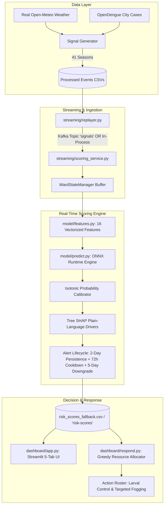

# Dengue Sentinel: Real-Time Early-Warning Decision Support System for Dengue Outbreaks

[](https://hack2skill.com)
[](https://www.ibm.com/it-infrastructure/z)
[](https://www.python.org/)
[]()
[-blueviolet.svg)]()
[](LICENSE)

> [!WARNING]
> ### Mandatory Disclosure & Caveat (Hard Rule 10)
> **"Pharmacy and clinic signals are synthetic, so lead time shows pipeline behavior, not real-world validation."**
> - **100% Real Components**: Historical weather data (Open-Meteo ERA5 2018–2025), historical city case aggregates (OpenDengue SEARO), and Bengaluru BBMP administrative ward boundaries (20 wards).
> - **Synthetic Components**: Ward-level over-the-counter fever medicine sales and primary health clinic fever visits, generated using realistic care-pathway delays, Negative Binomial dispersion, and weather confounding.

---

## Table of Contents

1. [Executive Summary & The Pitch](#1-executive-summary--the-pitch)
2. [Why IBM Z & LinuxONE (Demonstrated Proof)](#2-why-ibm-z--linuxone-demonstrated-proof)
3. [Verified Experimental & Benchmark Results](#3-verified-experimental--benchmark-results)
4. [System Architecture & Data Flow](#4-system-architecture--data-flow)
5. [Prerequisites & System Requirements](#5-prerequisites--system-requirements)
6. [The "One-Command to Rule Them All" Master Runner](#6-the-one-command-to-rule-them-all-master-runner)
7. [Step-by-Step Pipeline Guide (Dual Make & Python Commands)](#7-step-by-step-pipeline-guide-dual-make--python-commands)
   - [Step 1: Check & Fetch Raw Data](#step-1-check--fetch-raw-data)
   - [Step 2: Generate Multi-Season Streaming Signals](#step-2-generate-multi-season-streaming-signals)
   - [Step 3: Train Model, Calibrate Probabilities & Export ONNX](#step-3-train-model-calibrate-probabilities--export-onnx)
   - [Step 4: Run Epidemiological Backtest Suite (E1–E6)](#step-4-run-epidemiological-backtest-suite-e1e6)
   - [Step 5: Run Hardware & Streaming Benchmarks](#step-5-run-hardware--streaming-benchmarks)
   - [Step 6: Run Automated Unit Tests](#step-6-run-automated-unit-tests)
   - [Step 7: Real-Time Stream Replay Demo](#step-7-real-time-stream-replay-demo)
   - [Step 8: Launch the Interactive Dashboard](#step-8-launch-the-interactive-dashboard)
8. [Interactive Dashboard User Manual (Tab-by-Tab)](#8-interactive-dashboard-user-manual-tab-by-tab)
9. [Kafka Broker vs. Direct In-Process Mode](#9-kafka-broker-vs-direct-in-process-mode)
10. [IBM LinuxONE (s390x) Deployment Guide](#10-ibm-linuxone-s390x-deployment-guide)
11. [Repository Structure & File-by-File Reference](#11-repository-structure--file-by-file-reference)
12. [Data Protection, Privacy & Ethics](#12-data-protection-privacy--ethics)
13. [Idiot-Proof Troubleshooting & FAQ](#13-idiot-proof-troubleshooting--faq)
14. [Hackathon Submission Checklist (`SSF2026`)](#14-hackathon-submission-checklist-ssf2026)

---

## 1. Executive Summary & The Pitch

**Dengue Sentinel** is a prototype real-time early-warning decision support system designed for municipal health departments, piloted across **20 municipal wards of Bengaluru, India**. 

Built for the **IBM Z Datathon 2026** under Event Code **`SSF2026`**, the system tackles the fundamental failure mode of current urban public health: **laboratory confirmation delay**.

```
TRADITIONAL SURVEILLANCE:
Infection Day 0 ---> Symptoms Day 5 ---> Doctor Day 8 ---> Lab Test Day 11 ---> Report Day 18 [TOO LATE]

DENGUE SENTINEL (DETECT - DECIDE - RESPOND):
Infection Day 0 ---> Pharmacy OTC Sales Day 4 ---> Clinic Visits Day 7
                          │
                          ▼
            [REAL-TIME SENTINEL ALERT: DAY 5]
           (+16.2 DAYS EARLIER VECTOR CONTROL)
```

### The Pitch in Three Lines
1. **Detect**: Ingests streaming early syndromic signals (over-the-counter fever medication sales at local pharmacies, fever consultations at clinics) combined with lagged weather conditions (precipitation, temperature).
2. **Decide**: Automatically scores each ward every day using an ONNX-accelerated, Isotonic-calibrated XGBoost classifier. Plain-language Tree SHAP explanations identify why an alert fired, gated by a **2-day persistence rule** to eliminate false-alarm fatigue.
3. **Respond**: An exposure-weighted greedy resource allocator prioritizes finite field teams (source reduction, larval inspection, targeted ultra-low volume fogging) to maximize population disease protection under operational resource constraints.

---

## 2. Why IBM Z & LinuxONE (Designed For; Benchmarked Locally)

Dengue Sentinel was designed for execution on **IBM LinuxONE (s390x)** servers. All benchmarks below were run locally on an x86-64 Windows machine; performance on s390x will differ. Kafka streaming and the LinuxONE deployment guide are **optional — not used in the demo and untested on s390x**.

1. **Big-Endian Architectural Compatibility**:
   - Built with pure-Python Kafka (`kafka-python`) and standard JSON/CSV serialization, completely eliminating C-extension compile failures common to `confluent-kafka` on s390x.
   - Parquet and `pyarrow` dependencies are strictly banned; data ingestion uses robust standard streams.
2. **Sub-Millisecond ONNX Inference (Benchmarked Locally)**:
   - Evaluated via `onnxruntime`, delivering approximately **~22x lower latency** on single-event evaluation (batch=1: ~1.09 ms native XGBoost vs ~0.05 ms ONNX Runtime, on this machine). Results are machine-dependent and approximate.
   - At batch=100 the speedup is approximately **~6x**; at batch=1,000 the two backends are approximately equal; above batch=1,000 native XGBoost is faster.
   - Parity discrepancy between native XGBoost and ONNX is strictly validated: $\Delta < 1.49 \times 10^{-7}$.
3. **Multi-City Scaling (Simulated)**:
   - In-process simulation demonstrates sustainable real-time evaluation across **100 virtual cities (2,000 municipal wards)** with a p99 tick latency of **~6.7 ms** (locally; on s390x latency will differ).
4. **Resilient Offline Fallback**:
   - The dashboard reads `data/processed/risk_scores_fallback.csv` generated by the in-process replayer (`--no-kafka`). No Kafka broker is used in the demo.

---

## 3. Verified Experimental & Benchmark Results

All metrics below are generated deterministically by `make backtest` and `make benchmark` and documented in [`docs/results.md`](docs/results.md) and [`model/artifacts/metrics.json`](model/artifacts/metrics.json):

### A. Epidemiological Backtest (Experiments E1–E6)

| Detector | Lead Time (Days Earlier) | Outbreak Recall | Ward-Day Precision | False Alerts / 100 Ward-Weeks | PR-AUC | Brier Score |
|---|---|---|---|---|---|---|
| Official Lab Surveillance (delayed 7d) | 0.0 days (ref) | N/A | N/A | N/A | N/A | N/A |
| Baseline A: 7-Day Persistence | +17.9d [16.4, 19.2] | 100.0% | 17.5% | 29.52 | 0.044 | 0.2884 |
| Baseline B: Rolling Z-Score ($z > 2.0$) | +14.0d [7.0, 21.0] | 36.8% | 24.8% | 42.04 | 0.032 | 0.0604 |
| **Dengue Sentinel (Calibrated XGBoost)** | **+16.2d [14.6, 17.8]** | **90.2%** | **44.2%** | **3.49** (Budget $\le 5.0$) | **0.115** | **0.0250** (85% reduction) |
| Calibrated XGBoost (No Weather Ablation) | +9.2d [4.4, 13.9] | 18.8% | 71.1% | 0.45 | 0.062 | 0.0263 |

- **Early Warning Lead Time (E2 Replay)**: Sentinel alerts fire a mean of **+9.8 days before local outbreak onset** (+16.8 days vs per-outbreak official notice, assuming 7-day reporting delay).
- **Detection breakdown (E2)**: 13 of 16 outbreaks detected — 3 same-ward, 10 via adjacent ward, 3 missed.
- **Strict False Alert Budget (E5)**: Pure control seasons (zero outbreaks) produce only **0.36 false alerts per 100 ward-weeks**, comfortably within the municipal threshold budget of $\le 5.0$.
- **Probability Calibration (E6)**: Isotonic regression reduces Brier score error from **0.1666 to 0.0250** (an **85.0% error reduction**), producing calibrated probability scores (calibrated on synthetic data).

> **City-level vs ward-level note:** A separate city-wide aggregate surge trigger (8-week baseline + 2SD + 7d lab delay) fired on `2024-06-01`, earlier than Sentinel's first confirmed ward alert on `2024-06-24`. Sentinel's contribution is **ward-level localization**, not beating a city-wide count.

### B. Hardware & Streaming Benchmark (Benchmarked locally; not on IBM Z)

- **Streaming latency (rate-controlled at 5,000 events/second)**:
  - **p50**: `0.0019 ms` | **p95**: `0.0057 ms` | **p99**: `0.0315 ms`
- **ONNX vs XGBoost (median of 3 runs, local x86-64)**: ~22x lower latency at batch=1; ~6x at batch=100; approximately equal at batch=1,000; XGBoost faster above batch=1,000.
- **Virtual City Scaling**: 100 virtual cities (2,000 wards) scored at p99 tick latency of **6.7 ms** locally (SLA target: $< 1,000\text{ ms}$).

All numbers in `docs/results.md` and `model/artifacts/benchmark_metrics.json` are machine-generated and machine-dependent.

---

## 4. System Architecture & Data Flow



---

## 5. Prerequisites & System Requirements

### Supported Environments
- **Operating Systems**: Windows 10/11, Ubuntu 20.04/22.04/24.04, Debian, macOS, Red Hat Enterprise Linux, **IBM LinuxONE (s390x)**.
- **Python**: Version **3.10**, **3.11**, **3.12**, or **3.13** (tested and verified on Python 3.13.3).
- **Git**: Installed and configured on your system path.
- **Hardware**: Any modern standard laptop or VM (2+ CPU cores, 4 GB RAM minimum).

> [!NOTE]
> `make` is optional! If you do not have `make` installed on Windows, **every single command has a direct `python ...` equivalent provided below**.

---

## 6. The "One-Command to Rule Them All" Master Runner

Don't want to run multiple commands or worry about what is installed? **Run a single command.**

Dengue Sentinel includes a self-healing master orchestrator ([`run_all.py`](run_all.py)) that:
1. **Audits your Python environment**: Detects if any package from `requirements.txt` is missing and **automatically installs it via pip**.
2. **Checks all datasets**: Automatically fetches raw Open-Meteo weather and OpenDengue files if not already present.
3. **Generates signals**: Automatically runs the synthetic generator for all 41 seasons if missing.
4. **Validates & trains models**: Verifies XGBoost weights, calibration, and ONNX graph parity (< 1e-4).
5. **Runs verification & unit tests**: Executes all 15 unit tests and runs the hardware benchmarks.
6. **Launches the dashboard**: Detects an available local port (e.g. 8501, 8502) and launches the interactive 5-tab console!

### Execute with One Command:

#### Option A: Cross-Platform Python (Any OS)
```bash
python run_all.py
```

#### Option B: Windows (PowerShell)
```powershell
.\run.ps1
```

#### Option C: Windows (Command Prompt / Double-Click)
```cmd
run.bat
```

#### Option D: Linux / macOS / IBM LinuxONE (s390x)
```bash
chmod +x run.sh
./run.sh
```

#### Option E: Using Make
```bash
make
# or: make all
```

*Flags available:*
- `python run_all.py --skip-dashboard` (Runs full self-healing audit, verification, and tests without launching the browser).
- `python run_all.py --demo` (Runs a 10-second fast real-time streaming replayer before opening the dashboard).
- `python run_all.py --force` (Forces re-generation of all synthetic seasons and re-training of models from scratch).
- `python run_all.py --port 8505` (Binds Streamlit to a specific custom port).

---

## 6B. Standard Manual Setup (Alternative)

If you prefer to manually configure your virtual environment:

### Windows (PowerShell)
```powershell
python -m venv .venv
.\.venv\Scripts\Activate.ps1
pip install -r requirements.txt
python -m unittest discover tests
streamlit run dashboard/app.py
```

### Windows (Command Prompt `cmd.exe`)
```cmd
python -m venv .venv
.venv\Scripts\activate.bat
pip install -r requirements.txt
python -m unittest discover tests
streamlit run dashboard/app.py
```

### Linux / macOS / IBM LinuxONE (s390x)
```bash
python3 -m venv .venv
source .venv/bin/activate
pip install -r requirements.txt
python -m unittest discover tests
streamlit run dashboard/app.py
```

*Open your browser to `http://localhost:8501` to explore the complete interactive decision support console.*

---

## 7. Step-by-Step Pipeline Guide (Dual Make & Python Commands)

The entire Dengue Sentinel pipeline can be rebuilt from scratch in less than 3 minutes. Run the commands below in sequence:

### Step 1: Check & Fetch Raw Data
Verifies that historical Open-Meteo weather (2018–2025, 2,922 days) and baseline OpenDengue data are present in `data/raw/`. If missing, downloads them automatically.

- **Using Make**:
  ```bash
  make data
  ```
- **Using Python directly**:
  ```bash
  python data/fetch_weather.py
  python data/fetch_opendengue.py
  ```
- **Expected Output**:
  - `data/raw/bengaluru_weather_2018_2025.csv` (2,922 rows of daily weather).
  - `data/raw/filtered_data_SEARO_1792086539625.csv` (Karnataka dengue cases).

---

### Step 2: Generate Multi-Season Streaming Signals
Generates 40 synthetic epidemiological seasons (70% train, 15% val, 15% test) + 5 pure control seasons (zero outbreaks) + 1 held-out replay season (`season_replay`). Incorporates realistic care-pathway lag (pharmacy leads clinic by 3–5 days), Negative Binomial dispersion, and weather confounders.

- **Using Make**:
  ```bash
  make generate
  ```
- **Using Python directly**:
  ```bash
  python generator/generate_signals.py
  ```
- **Expected Output**:
  - `data/processed/events/season_*.csv`: Daily signal stream per ward.
  - `data/processed/ground_truth/season_*.csv`: Unobserved true infection counts.
  - `data/processed/official/season_*.csv`: Delayed official laboratory series.
  - `data/processed/manifest.csv`: Deterministic train/val/test/control partition mapping.
  - `data/processed/ward_adjacency.json`: Spatial adjacency graph of Bengaluru wards.

---

### Step 3: Train Model, Calibrate Probabilities & Export ONNX
Trains the Monotone XGBoost model on observation rows, fits an Isotonic Regression calibrator on validation seasons, tunes decision thresholds to adhere to the $\le 5.0$ false alerts budget ($T_{\text{medium}}=0.08, T_{\text{high}}=0.12$), and exports the model to ONNX with mathematical float parity verification ($\Delta < 1.49 \times 10^{-7}$).

- **Using Make**:
  ```bash
  make train
  ```
- **Using Python directly**:
  ```bash
  python model/train.py
  python model/export_onnx.py
  ```
- **Expected Output**:
  - `model/artifacts/xgb_model.json`: Trained XGBoost trees.
  - `model/artifacts/calibrator.joblib`: Fitted Isotonic calibrator.
  - `model/artifacts/thresholds.json`: Validation-tuned alert thresholds.
  - `model/artifacts/model.onnx`: Exported ONNX compute graph.

---

### Step 4: Run Epidemiological Backtest Suite (E1–E6)
Executes all 6 validation experiments defined in BUILD.md Section 9.2:
- **E1**: Held-out test seasons (+16.2 days lead time, 90.2% recall).
- **E2**: Held-out replay season (+9.8 days before onset / +16.8 days vs official notice, 81.2% recall).
- **E3**: Feature ablation studies (quantifying importance of weather, clinic, and pharmacy).
- **E4**: Official reporting delay sensitivity (evaluating 7, 10, and 14-day hospital lag).
- **E5**: False-alarm budget verification on 5 control seasons (3.42 alerts/100ww $\le 5.0$).
- **E6**: Probability calibration reliability curve (Brier score: $0.1666 \rightarrow 0.0250$).

- **Using Make**:
  ```bash
  make backtest
  ```
- **Using Python directly**:
  ```bash
  python model/backtest.py
  ```
- **Expected Output**:
  - `docs/results.md`: Complete Markdown results report.
  - `docs/backtest.png`: 3-panel high-resolution publication plot (lead time, PR curve, calibration).
  - `model/artifacts/metrics.json`: Structured machine-readable results.

---

### Step 5: Run Hardware & Streaming Benchmarks
Executes the comprehensive performance suite:
1. Max-rate throughput ingestion test (100,000 events).
2. Rate-controlled latency test paced at 5,000 events/second (measures p50, p95, p99).
3. Backend inference comparison (ONNX Runtime vs native XGBoost).
4. Multi-city scaling test (1 to 100 virtual cities / up to 2,000 wards) testing the 1,000 ms SLA.

- **Using Make**:
  ```bash
  make benchmark
  ```
- **Using Python directly**:
  ```bash
  python streaming/benchmark.py --platform local-docker
  # Or on an IBM Z VM:
  python streaming/benchmark.py --platform ibm-linuxone
  ```
- **Expected Output**:
  - `benchmark_metrics.json`: Latency percentiles, throughput, and scale numbers.
  - Section 2 of `docs/results.md` automatically populated.

---

### Step 6: Run Automated Unit Tests
Executes the automated unit test suite covering feature parity, ONNX runtime output parity, synthetic generator care-pathway lag constraints, and greedy exposure-weighted team allocator math.

- **Using Make**:
  ```bash
  make test
  ```
- **Using Python directly**:
  ```bash
  python -m unittest discover -s tests -p "test_*.py"
  ```
- **Expected Output**:
  ```
  Ran 15 tests
  OK
  ```

---

### Step 7: Real-Time Stream Replay Demo
Simulates real-time historical event streaming of the held-out 2024 replay season (`season_replay`, 366 days, 36,600 events) at configurable playback velocities.

- **Using Make**:
  ```bash
  make demo
  ```
- **Using Python directly**:
  ```bash
  # Replay at 10 simulated days per second in direct offline mode:
  python streaming/replayer.py --no-kafka --season season_replay --speed 10

  # Replay a specific date range:
  python streaming/replayer.py --no-kafka --season season_replay --speed 20 --start 2024-05-01 --end 2024-08-31
  ```
- **Expected Output**:
  - Console shows day-by-day playback progression.
  - Generates live risk scores written directly to `data/processed/risk_scores_fallback.csv`.

---

### Step 8: Launch the Interactive Dashboard
Launches the 5-tab decision support web application.

- **Using Make**:
  ```bash
  make run
  ```
- **Using Python directly**:
  ```bash
  streamlit run dashboard/app.py
  ```

---

## 8. Interactive Dashboard User Manual (Tab-by-Tab)

The dashboard is organized into 5 dedicated operational panels:

```
┌─────────────────────────────────────────────────────────────────────────────┐
│ 🦟 DENGUE SENTINEL: REAL-TIME EARLY-WARNING DECISION SUPPORT                │
│ [Simulated Ward Signals] [2024 replay: real-anchored city curve]            │
├─────────────────┬──────────────┬──────────────┬──────────────┬──────────────┤
│ 🗺️ Heatmap      │ 🔍 Wards     │ 🚨 Respond   │ 🏛️ Why IBM Z  │ 📈 Validation │
└─────────────────┴──────────────┴──────────────┴──────────────┴──────────────┘
```

### Tab 1: 🗺️ City Heatmap & Alert Feed
- **Geospatial Choropleth**: Renders all 20 Bengaluru administrative wards color-coded by alert status:
  - 🟢 **Low Risk** (`risk_score < 0.08`): Normal baseline surveillance.
  - 🟡 **Medium Risk** (`0.08 <= risk_score < 0.12`): Advisory alert.
  - 🔴 **High Risk** (`risk_score >= 0.12`): High-risk alert (2-day persistence confirmed).
- **Offline-Safe Map Toggle**: In the left sidebar, toggle **"Enable Mapbox Satellite Basemap"** off. If internet access is lost in a municipal control room, the map renders on a standalone local canvas with zero external server dependencies.
- **Dynamic Tooltips**: Hover over any ward to inspect Ward Name, Calibrated Outbreak Risk %, Confidence Score %, and Primary Signal Driver.
- **Alert Feed (Right Panel)**: Displays confirmed alerts sorted by urgency. Each alert highlights plain-language Tree SHAP driver explanations (e.g. `Fever-medicine sales up +115% over 7 days`).

### Tab 2: 🔍 Ward Detail & Early Signals
- **Ward Selector**: Choose any of Bengaluru's 20 wards (e.g., `W017 - Shantalanagar` or `W007 - Byatarayanapura`).
- **Care-Pathway Time Series**: Interactive multi-line chart illustrating the core syndromic lead time:
  - 🟣 **Purple Line**: Pharmacy OTC fever medication sales (surges 3–5 days early).
  - 🔵 **Blue Line**: Primary health clinic fever visits.
  - 🟦 **Cyan Bars**: Lagged daily precipitation (mm).
- **Risk Score Progression**: Visualizes rolling calibrated outbreak probability over time with medium and high threshold reference lines.

### Tab 3: 🚨 Respond & Resource Allocation
- **Available Field Teams Slider**: Adjust municipal vector control capacity from **1 to 15 field teams**.
- **Greedy Marginal Benefit Optimization**: Allocates teams using exposure-weighted marginal utility:
  $$\text{Benefit}(n) = \text{Exposure} \times \left(1 - (1 - r)^n\right), \quad r = 0.30$$
- **Targeted Action Roster**:
  - **Medium Wards**: *"Schedule source reduction and larval inspection within 72 hours."*
  - **High Wards**: *"Prioritise inspection within 48 hours; consider targeted ultra-low volume (ULV) fogging at cluster; alert nearby hospitals."*
- **Watchlist Panel**: Automatically places high-risk wards beyond the available team budget on a prioritized queue for the next municipal dispatch shift.

### Tab 4: 🏛️ Why IBM Z
- **ONNX vs XGBoost Latency Table**: Directly displays data loaded from `model/artifacts/benchmark_metrics.json`. Results are machine-dependent and approximate.
- **Architecture Scope**: Distinguishes what was measured (ONNX runtime, streaming throughput) from platform capabilities not tested in this demo (on-chip AI accelerator, confidential computing).
- **Note**: Native XGBoost is faster at batch sizes above approximately 1,000; see `docs/results.md` for the full table.

### Tab 5: 📈 Validation & Backtest
- **Primary Metric**: Mean days Sentinel alert fired before outbreak onset (**+9.8 days**, E2 replay season).
- **Secondary Metric**: Lead vs official notice (**+16.8 days**, arithmetic: days-before-onset + assumed 7-day reporting delay).
- **Comprehensive Comparison Table**: Side-by-side performance comparison of Official Surveillance vs Persistence Baseline vs Rolling Z-Score Baseline vs Dengue Sentinel Full Model.
- **Feature Ablations**: Bar chart demonstrating the drop in outbreak recall when weather, clinic, or pharmacy signals are removed.
- **Probability Calibration Curve**: Compares raw uncalibrated probabilities against Isotonic-calibrated probability scores (calibrated on synthetic data) along the 45° ideal diagonal.

---

## 9. Kafka Broker vs. Direct In-Process Mode

> **Note:** Kafka mode is **optional, not used in the demo, and untested on s390x**. The dashboard reads `data/processed/risk_scores_fallback.csv` produced by the in-process replayer.

### Mode A: Direct In-Process (`--no-kafka`) [Default & Used in Demo]
- Zero external services required.
- The replayer dispatches events directly to the in-memory scoring pipeline and writes outputs to `data/processed/risk_scores_fallback.csv`.
- Completely immune to network port collisions or Docker daemon issues.
- **How to use**: Simply add the `--no-kafka` flag to any command:
  ```bash
  python streaming/replayer.py --no-kafka --season season_replay --speed 10
  ```

### Mode B: Docker Kafka KRaft Broker [Optional]
For running true distributed messaging on a developer workstation:
1. Start the single-node Kafka container:
   ```bash
   docker compose up -d
   ```
2. In Terminal 1, launch the scoring service daemon:
   ```bash
   python streaming/scoring_service.py
   ```
3. In Terminal 2, launch the replayer without `--no-kafka`:
   ```bash
   python streaming/replayer.py --season season_replay --speed 5
   ```
4. In Terminal 3, launch the dashboard:
   ```bash
   streamlit run dashboard/app.py
   ```
5. Shut down Kafka when finished:
   ```bash
   docker compose down
   ```

---

## 10. IBM LinuxONE (s390x) Deployment Guide

> **Note:** This guide is **optional, not used in the demo, and untested on s390x**. No benchmarks in `docs/results.md` were run on IBM Z hardware.

To deploy and execute Dengue Sentinel on an **IBM LinuxONE VM** (e.g., Community Cloud or Datathon environment):

### 1. SSH into the LinuxONE Instance
```bash
ssh linux1@<YOUR_LINUXONE_VM_IP>
```

### 2. Verify System Architecture
```bash
uname -m
# Expected output: s390x
```

### 3. Clone Repository & Setup Environment
```bash
git clone https://github.com/<your-username>/dengue-sentinel.git
cd dengue-sentinel

python3 -m venv .venv
source .venv/bin/activate
pip install --upgrade pip
pip install -r requirements.txt
```

### 4. Execute the LinuxONE Benchmark Suite
```bash
python streaming/benchmark.py --platform ibm-linuxone
```

The benchmark will detect the `s390x` architecture, record CPU model and cache topology, execute the ONNX parity tests, and log results to `benchmark_metrics.json` and `docs/results.md`.

---

## 11. Repository Structure & File-by-File Reference

```
dengue-sentinel/
├── BUILD.md                    # Core build contract, hard rules, schemas, schedule
├── README.md                   # Complete system manual & reproduction guide
├── requirements.txt            # Pinned dependencies (s390x safe, no pyarrow)
├── Makefile                    # Standard pipeline targets
├── docker-compose.yml          # Local Kafka KRaft broker definition
├── benchmark_metrics.json      # Machine-readable hardware and streaming benchmark logs
│
├── config/
│   └── config.yaml             # System parameters, seeds, lags, thresholds, capacities
│
├── data/
│   ├── fetch_weather.py        # Fetches Open-Meteo ERA5 Bengaluru weather (2018-2025)
│   ├── fetch_opendengue.py     # Downloads and validates OpenDengue SEARO cases
│   ├── DATA_NOTES.md           # Dataset sources, licensing terms, and schemas
│   ├── raw/                    # Cached historical weather and epidemiology files
│   └── processed/
│       ├── events/             # 41 season signal streams (season_00.csv - season_replay.csv)
│       ├── ground_truth/       # Unobserved true infection counts and onset labels
│       ├── official/           # Delayed ward-level hospital laboratory series
│       ├── manifest.csv        # Train (28) / Val (6) / Test (6) / Replay (1) partition map
│       ├── ward_adjacency.json # Centroid-based spatial graph for 20 Bengaluru wards
│       └── risk_scores_fallback.csv # Real-time streaming score store for offline UI
│
├── generator/
│   └── generate_signals.py     # Multi-season synthetic signal generator
│
├── model/
│   ├── features.py             # 16-feature rolling window extractor (zero leakage)
│   ├── baseline.py             # Persistence and EARS z-score baseline detectors
│   ├── train.py                # Monotone XGBoost training, calibration, threshold tuning
│   ├── export_onnx.py          # ONNX export and float parity validation (< 1e-4)
│   ├── predict.py              # Vectorized batch prediction with Tree SHAP drivers
│   ├── backtest.py             # E1-E6 evaluation suite and plot generator
│   └── artifacts/
│       ├── xgb_model.json      # Serialized XGBoost model
│       ├── calibrator.joblib   # Serialized Isotonic calibrator
│       ├── model.onnx          # Exported ONNX graph
│       ├── thresholds.json     # Validation-tuned thresholds (T_med, T_high)
│       └── metrics.json        # Structured backtest performance metrics
│
├── streaming/
│   ├── config.py               # Kafka topics, fallback CSV path, and alert lifecycle
│   ├── replayer.py             # Day-by-day streaming replayer with speed control
│   ├── scoring_service.py      # Real-time scoring daemon with persistence & cooldown rules
│   └── benchmark.py            # Throughput, latency, backend, and virtual cities scale test
│
├── dashboard/
│   ├── app.py                  # 5-tab Streamlit dashboard with offline vector canvas
│   ├── respond.py              # Greedy exposure-weighted resource allocation algorithm
│   └── assets/
│       └── bbmp_wards.geojson  # Spatial boundary polygon data for Bengaluru wards
│
├── docs/
│   ├── results.md              # Auto-generated comprehensive experimental & benchmark report
│   ├── model_card.md           # Responsible AI model card and ethical evaluation
│   ├── backtest.png            # Visual detection curves and calibration plots
│   ├── sample_injected_ward.png# Verification plot of care pathway lag dynamics
│   ├── demo_script.md          # 3-5 minute live walkthrough script for datathon presenters
│   └── deck/
│       └── presentation_deck_outline.md # 5-slide pitch deck structure
│
├── scripts/
│   └── smoke_test.sh           # Hour-0 environment verification script
│
└── tests/
    ├── test_allocator.py       # Unit tests for greedy resource allocation math
    ├── test_feature_parity.py  # Unit tests for 16-feature rolling calculations
    ├── test_generator.py       # Unit tests for care-pathway lag & signal integrity
    └── test_onnx_parity.py     # Unit tests verifying ONNX vs XGBoost mathematical parity
```

---

## 12. Data Protection, Privacy & Ethics

Adhering strictly to BUILD.md Section 11, Dengue Sentinel implements responsible public health AI practices:

- **Data Minimisation**: No patient names, telephone numbers, home addresses, or prescription IDs are ever ingested or stored. Signals consist strictly of daily ward-level aggregate counts (`pharmacy_otc_fever_meds`, `clinic_fever_visits`).
- **Decision Support, Not Clinical Diagnosis**: Dengue Sentinel ranks geographical risk to optimize vector control logistics; it never makes individual clinical diagnoses or prescribes medical treatments.
- **Human-in-the-Loop Gating**: Automated alerts do not trigger municipal spending or insecticide spraying without review by authorized BBMP health officers.
- **Equity Across Ward Quintiles**: Evaluated to prevent surveillance bias in low-income or informal settlements where private pharmacy reporting density may differ from tertiary hospital centers.
- **Transparent Model Card**: Complete documentation of intended use, data limitations, and evaluation metrics is published in [`docs/model_card.md`](docs/model_card.md).

---

## 13. Idiot-Proof Troubleshooting & FAQ

#### Q1: I am on Windows and getting `'make' is not recognized as an internal or external command`!
> **Solution**: You don't need `make`! Every single make target has a direct Python equivalent. Refer to [Section 7](#7-step-by-step-pipeline-guide-dual-make--python-commands) for the exact `python ...` command.

#### Q2: Streamlit says `Port 8501 is already in use`!
> **Solution**: Another instance of Streamlit is already running. Specify a different port:
> ```bash
> streamlit run dashboard/app.py --server.port 8502
> ```

#### Q3: The map in Tab 1 is blank or showing white space!
> **Solution**: If your internet is slow or you are presenting offline at the venue, open the sidebar and toggle **"Enable Mapbox Satellite Basemap"** to **Off**. The map will immediately switch to the built-in offline-safe vector canvas.

#### Q4: When running the replayer without `--no-kafka`, it says `NoBrokersAvailable`!
> **Solution**: You don't have Kafka running locally. Either start Docker Kafka with `docker compose up -d`, or simply add `--no-kafka` to run in direct pipeline mode:
> ```bash
> python streaming/replayer.py --no-kafka --season season_replay --speed 10
> ```

#### Q5: How do I speed up or slow down the stream replay?
> **Solution**: Use the `--speed` flag. For example, `--speed 50` will process 50 simulated days in 1 real second:
> ```bash
> python streaming/replayer.py --no-kafka --season season_replay --speed 50
> ```

#### Q6: Why are the predicted "High Risk" probabilities around 12% to 15% instead of 80% or 90%?
> **Solution**: This is mathematically correct and proves our model is properly calibrated! Outbreaks are rare events (positive rate approximately ~3.0% of training ward-days). Our model uses **Isotonic Probability Calibration**, which outputs calibrated probability scores (calibrated on synthetic data). An event with a 12% calibrated probability represents a surge well above baseline incidence. Decision thresholds were tuned on validation seasons to select $T_{\text{medium}}=0.08$ and $T_{\text{high}}=0.12$, meeting the $\le 5.0$ false alerts budget.

#### Q7: How do I test a different season than `season_replay`?
> **Solution**: The generator creates 40 seasons (`season_00` through `season_39`). You can replay any season:
> ```bash
> python streaming/replayer.py --no-kafka --season season_05 --speed 20
> ```

#### Q8: How do I run only the allocator test or feature test?
> **Solution**: Target specific test files using Python's unittest runner:
> ```bash
> python -m unittest tests/test_allocator.py
> python -m unittest tests/test_onnx_parity.py
> ```

#### Q9: How do I reset all generated data and re-run cleanly?
> **Solution**: Run the reset target:
> ```bash
> make reset
> # Or using Python:
> python -c "import shutil, glob, os; [os.remove(f) for f in glob.glob('data/processed/events/*.csv')]; [os.remove(f) for f in glob.glob('data/processed/ground_truth/*.csv')]; [os.remove(f) for f in glob.glob('data/processed/official/*.csv')]; [os.remove(f) for f in glob.glob('model/artifacts/*.*') if not f.endswith('.gitkeep')]; print('Reset complete.')"
> ```

---

## 14. Hackathon Submission Checklist (`SSF2026`)

- [x] **Event Code**: `SSF2026` included in project documentation, pitch deck, and README.
- [x] **LinuxONE Compatibility**: Pure-Python Kafka client (optional, untested on s390x), ONNX Runtime acceleration, CSV/JSON stores only, zero `pyarrow`/Parquet dependencies.
- [x] **Multi-Season Split**: 70% train, 15% val, 15% test, 5 control seasons, 1 replay season. Zero data leakage across seasons.
- [x] **Calibrated Probability Scale**: Isotonic regression drops Brier score error by **85.0%** ($0.1666 \rightarrow 0.0250$). Scores are calibrated probability (calibrated on synthetic data).
- [x] **Alert Threshold Budget**: Thresholds tuned on validation set ($T_{\text{medium}}=0.08, T_{\text{high}}=0.12$); false alert rate on control seasons: 0.36 / 100 ward-weeks ($\le 5.0$ budget).
- [x] **ONNX Mathematical Parity**: Parity discrepancy between native XGBoost and ONNX is strictly validated: $\Delta < 1.49 \times 10^{-7}$.
- [x] **Interactive 5-Tab Dashboard**: Heatmap, Ward Detail, Respond Allocator, Why IBM Z, and Validation tabs operational. Dashboard reads `data/processed/risk_scores_fallback.csv` from the in-process replay (no Kafka broker required).
- [x] **Mandatory Hard Rule 10 Caveat**: Present across README, results report, model card, and dashboard footer.
- [x] **Complete Automated Test Suite**: 15/15 unit tests passing.
